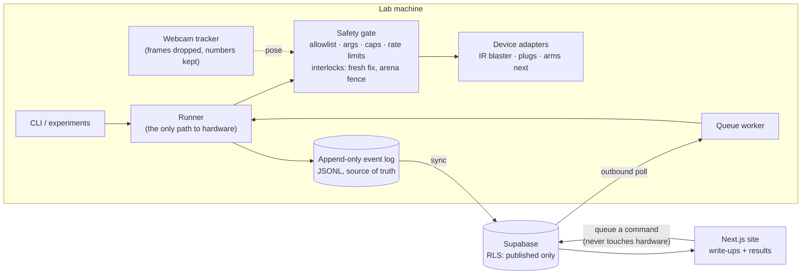

# Physical AI Lab

[](https://github.com/sol-dev-44/physical-ai-lab/actions/workflows/ci.yml)

A home robotics lab built like production infrastructure, and documented from day one.
Cheap hardware first (a toy robot, an IR blaster, a webcam) to prove the harness; two
LeRobot arms next.

**The idea:** every experiment, in any language, writes to one append-only event log.
Every hardware command goes through one gated path. Replay, evals, the website and the
write-ups only ever read the logs. So every result can be traced back to the exact
commands, safety decisions and observations behind it.

## Results so far

| Experiment | Question | Result |
|---|---|---|
| [exp000: IR bridge](experiments/exp000-ir-bridge/README.md) | Can a $30 IR blaster drive real devices safely through the harness? | A toy robot driven from the CLI and from the website through a queue. Jerky motion traced to Wi-Fi latency; fixed by having the device play each timed move from one frame, which also closed a safety-cap gap ([ADR 0008](docs/adr/0008-device-played-holds.md)). |
| [exp001: vision observer](experiments/exp001-vision-observer/README.md) | Can a webcam replace the human judge, and keep the robot safe? | 30 steered moves, **29 of 29 tracked moves judged correctly**, robot kept in the middle of a 95 × 70 cm arena with **zero safety refusals**. Position to about 1 mm; heading learned from motion. |
| [Rust in the browser](content/log/2026-11-10-wasm-replay-viewer.mdx) | Should the replay viewer be Rust/WASM? | Measured **2.6× slower to load, 1.8× slower to scrub** than TypeScript, so TypeScript stays ([ADR 0004](docs/adr/0004-rust-policy.md)). |

Lab notes and write-ups: [`content/log`](content/log), [`content/experiments`](content/experiments).

## How it works



Design rules, each enforced in code or tests rather than just written down
([full list](docs/architecture.md#invariants-each-is-enforced-somewhere-not-just-written-down)):

- **One event contract, three languages.** Defined in TypeScript (zod), mirrored in
  Python (pydantic) and Rust (serde). Shared valid and invalid fixtures run in all three
  test suites, and CI cross-checks that Python and Rust compute identical summaries from
  the same runs.
- **One path to hardware.** Every request is checked by the safety gate (STOP file,
  allowlist, argument validation, duration caps, confirmation, rate limits, then world-
  state interlocks), and every decision is logged, including refusals and their reason.
- **Sensors report, the gate decides.** The camera only says where the robot is.
  Whether a move is allowed (fresh fix? would it leave the arena?) is an interlock in the
  gate, tested like any other rule.
- **The website never touches hardware.** It can only insert `(tool, args, confirmed)`
  into a queue; database policies fill in who asked, and the lab machine decides.
- **Privacy by default.** Camera frames are tracked and dropped; only numbers are kept.
  Saving a frame needs an explicit "nobody in frame" flag, and never leaves the machine.
- **Rust where it measurably earns its place.** Ports are benchmarked against what they
  replace, and the write-up says why either way.

## Engineering highlights

- **Device-played timed moves.** A hold is sent as one IR frame with a repeat count, so
  Wi-Fi jitter can't chop up the motion and a long recorded code can't outlast the
  gate's time cap ([ADR 0008](docs/adr/0008-device-played-holds.md)).
- **A camera judge on a busy floor.** Background subtraction in Lab colour with separate
  chroma and lightness thresholds (shadows ignored), global auto-exposure correction,
  shiny-tape masking, a perspective homography to centimetres, and robot-sized blob
  selection.
- **Heading from motion.** Stickers on the toy were steady when still and unusable when
  moving, so the tracker reports position only and each move sets the heading from its
  own travel, corrected by the measured turn per press.
- **A fence with a motion model.** Measured: every press moves the toy about 20 cm,
  whatever the hold length. The fence predicts each move's end (fixed step plus
  per-second speed, direction, slack), allows recovery moves only if even their worst case
  ends further inside, and with the heading unknown allows only moves safe in any
  direction.
- **A simulator for every piece.** Robot, IR blaster and overhead camera are simulated,
  so tracking, the judge, the fence and full runs are tested without hardware.
- **Tested access control.** Supabase row-level security is pinned by SQL tests
  (published-only reads, admin-only queueing, `requested_by` set by the database).

## What's next: Phase 1 with two LeRobot arms

Same harness, real stakes:

1. A real stop path, in place before any autonomous motion.
2. Teleoperated demonstrations (one arm leading, one following), recorded into the same
   event log.
3. Camera evals judging every attempt, the way exp001 judges the toy.
4. A first learned policy trained on those demonstrations, measured against them.

Then reinforcement learning, with the camera as the reward.

## Repo map

```
apps/web/            Next.js 16 (Cache Components): public site + gated /admin
packages/schema/     the event contract: zod source, generated JSON Schema, fixtures
services/lab-agent/  Python: tool registry, safety gate, runner, devices, sync, queue worker
crates/              Rust: lab-events (contract mirror + WASM build), labctl (log tooling)
experiments/         one folder per experiment, any language
content/             MDX write-ups: experiments, lab log, builds
supabase/            migrations + RLS tests
docs/                architecture + decision records (ADRs)
scripts/             cross-language checks
```

| Layer | Stack |
|---|---|
| Site | Next.js 16, React, TypeScript, MDX, Vercel |
| Data | Supabase (Postgres, RLS), JSONL event logs |
| Lab agent | Python 3.12, uv, pydantic, OpenCV, NumPy, python-broadlink |
| Tooling | Rust (serde, clap, wasm-bindgen), Turborepo, pnpm, Vitest, pytest, ruff |

## Try it

Needs Node 22+, pnpm 10, uv and Rust stable. No hardware or accounts needed.

```bash
pnpm install && uv sync --all-packages && cargo build

pnpm dev                                          # the site at http://localhost:3000
cd services/lab-agent
uv run exp001 --sim check                         # simulated camera tracking a simulated robot
uv run lab --help                                 # the lab CLI: sessions, trials, replay, agent
```

On the lab machine, add `--extra hardware` to `uv sync` for the real device drivers.
Supabase setup: [supabase/README.md](supabase/README.md).

## Checks

CI runs all of these on every push (six jobs: TypeScript, Python, Rust, WASM, database,
cross-language):

```bash
pnpm check                        # TS: lint, typecheck, tests (incl. contract), build
uv run ruff check . && uv run pytest
cargo clippy --all-targets -- -D warnings && cargo test
supabase/tests/run.sh             # RLS tests, needs a local Postgres
scripts/crosscheck.sh             # Python writes runs, Rust validates, summaries must match
```

## Read more

- [Architecture](docs/architecture.md): diagram, invariants and where each is enforced,
  known gaps, how to add things.
- [Decision records](docs/adr/README.md): the eight decisions that shaped the lab.
- [exp001 lab notebook](experiments/exp001-vision-observer/README.md): every run, what
  went wrong, and the gotchas.
