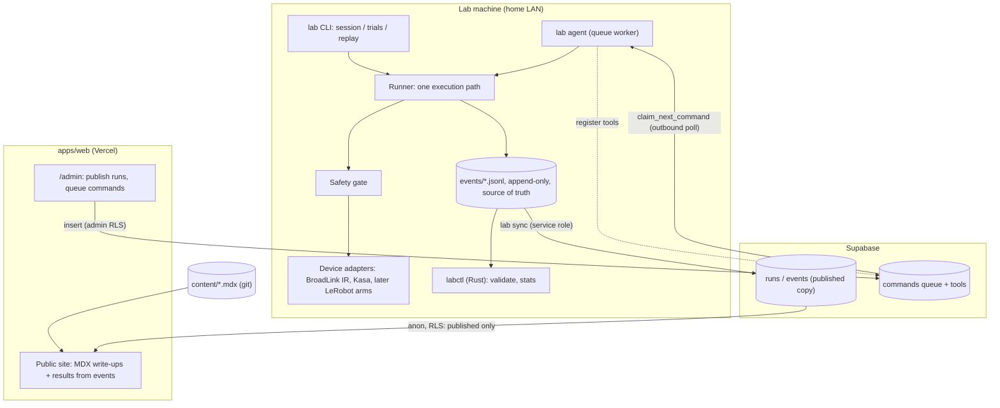

# Architecture

## Repo map

| Path | What |
|---|---|
| `packages/schema` | Event contract (zod source, generated JSON Schema, shared fixtures, TS fold) |
| `apps/web` | Next.js 16 site: public pages + gated `/admin` |
| `services/lab-agent` | Python: registry, safety gate, runner, devices, sync, queue worker |
| `crates/lab-events`, `crates/labctl` | Rust: contract mirror + log tooling |
| `experiments/<id>` | Per-experiment code, tool sets, protocol; any language |
| `content/` | MDX write-ups: `experiments`, `log`, `builds` |
| `supabase/` | Migrations and RLS tests |
| `docs/adr` | Decisions and their reasons |

## Invariants (each is enforced somewhere, not just written down)

| Invariant | Enforced by |
|---|---|
| Every implementation agrees on the event format | Shared fixtures in TS, Python and Rust tests; JSON Schema drift check |
| Python and Rust compute identical summaries on real runs | `scripts/crosscheck.sh` in CI |
| Logs are append-only and gap-free | `validate_log` in all three languages; DB triggers and unique `(run_id, seq)` |
| Nothing invalid is ever written | `EventLog.append` validates before writing |
| Hardware is reachable only through the gate | Runner is the only caller of handlers; web has no device path |
| Stale or remote commands can't fire dangerous tools | `claim_next_command` expiry; `manual_only` rule for `remote` |
| Only published runs are public | RLS policies, tested in `supabase/tests/rls_test.sql` |
| Write-ups have valid front matter | zod at build + `apps/web/test/content.test.ts` |
| Site builds with no secrets | CI builds without Supabase env |

## Adding things

- **New event type**: edit `packages/schema/src/event.ts`, `pnpm schema:gen`, add valid + invalid fixtures, mirror in Python and Rust, update the folds if it counts toward a summary. CI fails until all three agree.
- **New device**: adapter in `services/lab-agent/src/lab_agent/devices/`, no safety logic in it.
- **New tool set**: a `build() -> Registry` function in the experiment's package; point `LAB_TOOLS` at it.
- **New experiment**: `experiments/expNNN-name/` (code) + `content/experiments/expNNN-name.mdx` (write-up). If Python, add it to `[tool.uv.workspace].members`.
- **New write-up collection**: schema in `apps/web/lib/content/collections.ts`, routes via `collectionIndex` / `collectionDetail`.
