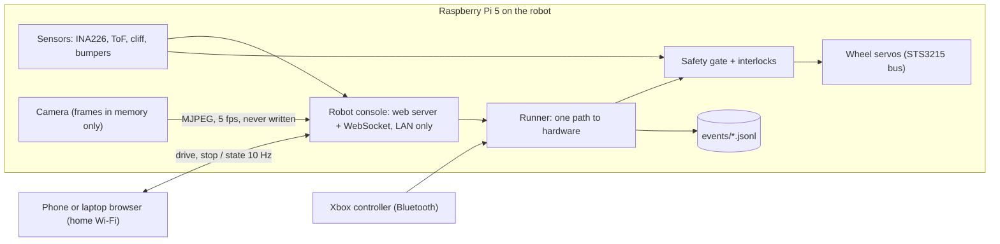

# Robot console: the control app (design)

Decided with the owner on 2026-11-21. The robot gets a control app: drive it, watch its sensors,
debug it, and see the lab's inventory. This is the design; the implementation plan comes next.

## Decisions

| Question | Decision |
|---|---|
| Where it lives | Both, local first. A fast app on the home network now; later a status card and "go do X" commands on the public site, through the existing commands queue ([ADR 0003](../../docs/adr/0003-web-never-touches-hardware.md)). |
| What it is | A web app served by the robot's Raspberry Pi. Open it in any browser on home Wi-Fi; nothing to install. |
| Camera | A live view for debugging, on the home network only. Never recorded, synced or posted ([ADR 0007](../../docs/adr/0007-child-privacy.md), [ADR 0013](../../docs/adr/0013-owner-governs-personal-data.md); made explicit in ADR 0014). |
| Inventory | Shown in the app, read only. `docs/inventory.md` stays the one record and agents update it with each change. |

## How it fits together

- **Robot console** (`services/lab-agent/src/lab_agent/console/`): a small web server in the lab
  agent, bound to the home network only. It serves the app's built files, holds one WebSocket per
  browser, streams state, and turns drive input into `Runner.request` calls. It never talks to a
  device itself ([AGENTS.md](../../AGENTS.md): hardware only through `Runner.request`).
- **The app** (`apps/robot-console/`): React and TypeScript, built to static files that the
  console serves. A standalone app in the sense of [ADR 0005](../../docs/adr/0005-standalone-apps.md),
  except that it is served by the robot rather than deployed to a subdomain.
- **Xbox controller:** pairs with the Pi over Bluetooth and is read on the Pi, so driving works
  with or without the page open. Its input takes the same `Runner.request` path, with its own
  actor name.
- **Connectivity:** the Pi 5 has dual-band Wi-Fi and Bluetooth 5.0 on board. Use 5 GHz Wi-Fi: on
  the Pi, Wi-Fi and Bluetooth share one radio, and 2.4 GHz traffic makes the controller laggy. Keep
  metal away from the Pi's on-board antenna (the electronics deck at the back of the plate, above
  the plate and away from the battery).

## Safety

- **Drive is a lease.** A `drive` command sets wheel speed for at most 300 ms. The browser sends a
  heartbeat every 100 ms while the joystick or drive button is held; each heartbeat renews the
  lease. If heartbeats stop (released button, closed tab, dropped Wi-Fi, crashed browser), a
  watchdog in the agent sends a stop through the runner within the lease. A new interlock,
  `drive_lease`, refuses drive commands with no live lease.
- **Limits in the tool schema:** linear speed at most 0.3 m/s, turn rate at most 1.5 rad/s.
  Phase 2 adds the bumper, forward ToF, cliff and battery interlocks; the app shows each refusal
  with its rule.
- **The physical e-stop always wins.** It cuts motor power and the Pi stays up to log it.
- **Open risk:** a bus servo in wheel mode keeps turning at its last speed until told otherwise.
  If the agent itself dies, the watchdog dies with it. The plan must check Feetech's STS3215
  documentation for a communication-loss stop or torque limit, and otherwise add an independent
  watchdog (for example, a separate process or a hardware timer that cuts the motor rail). Until
  that is settled, drive only with someone at the e-stop.
- **Access:** the console listens on the home network only: no port forwarding, no tunnel.
  Remote driving is phase 4 (Tailscale), with its own decision. On start the console prints a
  pairing link with a random token; the browser keeps it in a cookie and every request and
  WebSocket must carry it. Plain HTTP on the LAN is acceptable for v1 because the browser does
  not need the Gamepad API (the controller is read on the Pi).

## What gets logged

- Drive commands go through the runner, so each is logged with its gate decision. To keep the log
  readable, the app sends a new drive command only when the joystick moves meaningfully (at most
  10 per second); heartbeats renew the lease and are not logged. A lease expiry logs a stop.
- Sensor readings are live only, not events: v1 does not change the event contract. Anything
  that matters for safety shows up as a gate decision (for example, a refusal for low battery).
- This is what restarts the event log: the first bench drive writes the first exp003 events.

## Screens (v1)

| Screen | Shows |
|---|---|
| Drive | On-screen joystick, speed slider (capped), big stop button, lease and connection state, Xbox controller connected and its battery |
| Sensors | Battery voltage, current, charge and run-time estimate (INA226); each servo's temperature, load and voltage; the three forward ToF distances drawn as a small radar; cliff sensors; bumpers; Wi-Fi signal; Pi temperature; e-stop and STOP file state |
| Camera | Live view at about 5 frames per second for debugging; privacy-shutter and listening-light state; nothing saved |
| Log | The latest commands and gate decisions from the event log, refusals with the rule that made them |
| Inventory | Filament and parts stock, low-stock warnings, orders to place and the print log, read from `content/builds/household-robot.data.json` (already exported from `docs/inventory.md` and validated) |

Not in v1: a map, who the robot recognises, voice transcripts, schedules, the public-site status
card and queued commands. Each comes with the phase that makes it possible.

## Protocol (WebSocket, JSON)

- Browser to robot: `hello {token}`, `drive {v, w, seq}`, `heartbeat {seq}`, `stop {}`.
- Robot to browser: `state {...}` at 10 Hz (battery, servos, distances, cliffs, bumpers, Wi-Fi,
  Pi temperature, lease, e-stop, STOP file, controller), `event {...}` for each new log line,
  `refused {rule, reason}` when the gate denies a drive.
- The message types live in one schema shared by the server (pydantic) and the app (zod), with
  fixtures tested on both sides, the same way the event contract is kept in step.

## Order of work

1. **Console skeleton on fake devices** (runs on the Mac): server, pairing, WebSocket, state
   stream from fake sensors, Drive screen, `drive` tool, lease interlock and watchdog, logged
   through the runner. Fits phase 0 on the bench.
2. **Real wheels:** STS3215 adapter behind the runner (via the servo driver board), the Xbox
   controller on the Pi, the watchdog risk above settled. Phase 0's "drives for 10 minutes with a
   dead-man" is done when it works from both the controller and the app.
3. **Sensors, Log and Inventory screens** as the sensors are wired (phase 1 and 2).
4. **Camera screen** when the camera is on the robot, after ADR 0014.
5. **Later:** public-site status card and queued commands; map and recognition views.

## Testing

- Gate: the lease interlock and speed caps get tests like every other rule, including tests that
  show they can fail (a drive with an expired lease is refused; a 0.5 m/s request is refused).
- Watchdog: a test that stops heartbeats and checks a logged stop within 300 ms, on fake devices.
- Console: protocol tests against the server (token required, drive goes through the runner,
  refusals reach the browser).
- App: component tests for each screen against recorded state messages, and a browser smoke
  test against the console running on fake devices.
- On the robot: phase 0 and 1's "done when" rows, plus pulling the Wi-Fi and closing the tab
  mid-drive (both must stop the wheels).

## ADR 0014 (to write before step 1)

The robot console on the home network: an inbound port on the robot, home network only, behind
a pairing token, never exposed to the internet; it is a client of the runner like the CLI and the
queue worker. The live camera view is allowed on the home network for debugging and is never
written, synced or posted.
